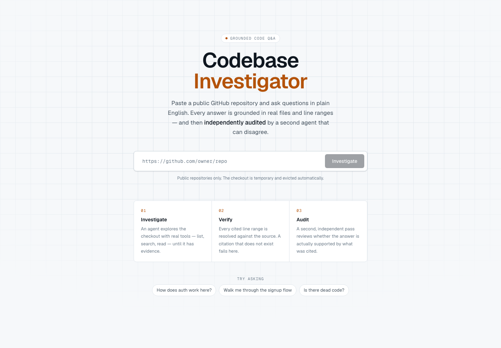
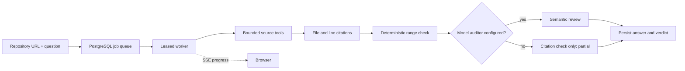
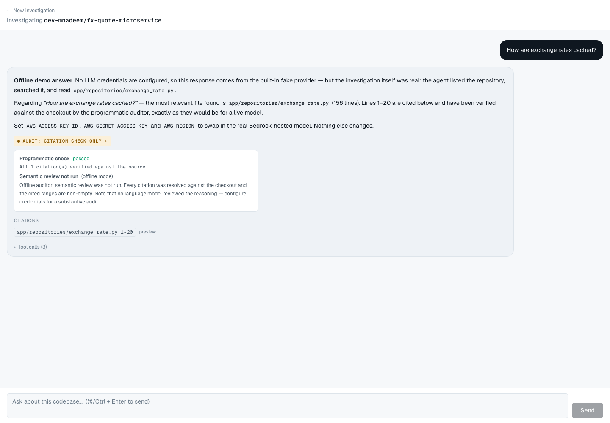

# Codebase Investigator

Paste a public GitHub repository URL and ask questions about the code in plain English. Answers cite specific files and line ranges. Each answer then goes through an audit step: a deterministic checker confirms the cited lines exist in the checkout, and a second model pass reviews the answer. The final verdict (trusted, partial or suspect) is the worse of the two.



## How it works

1. Creating a session downloads the repo tarball, caps its size and strips unsafe entries.
2. A question is queued as a job (the API returns 202) and a worker picks it up. Progress is streamed to the browser over SSE.
3. The agent uses five tools (`search_code`, `read_file`, `grep`, `list_dir`, `find_files`) for up to 12 turns, then submits an answer with citations.
4. Citations are checked against the files, the auditor gives its opinion, and the message, citations and verdict are saved in one transaction.



`search_code` ranks files with BM25 over identifier-aware tokens, so a question about "authentication" can still find `auth.ts`.



## Stack

- Backend: NestJS 11, TypeScript, Prisma, PostgreSQL, AWS Bedrock, Jest, Swagger
- Frontend: Next.js 16, React 19, TanStack Query, Tailwind

## Run with Docker

```bash
docker compose up --build
```

- Web app: http://localhost:3100
- API: http://localhost:4000/api (Swagger at `/api/docs`)

You don't need any credentials. Without AWS keys the backend uses an offline provider that runs the same tool loop against the real checkout and produces real citations. It's useful for demoing and testing the pipeline, but no model is reasoning about the code in that mode. Offline answers stay `partial`, and the badge reads **Citation check only**; valid line references do not prove that an answer is correct. To use a live model, copy `investigator-be/.env.example` to `.env`, add the AWS values and restart.

## Run without Docker

Use Node 22 and a PostgreSQL database. Set both `DATABASE_URL` and `DIRECT_URL` in
`investigator-be/.env`; for a local database they can be the same connection URL.
`DIRECT_URL` is used by migrations, while `DATABASE_URL` is used by the running API.

```bash
cd investigator-be
npm ci
cp .env.example .env
npx prisma migrate deploy
npm run start:dev        # port 4000

cd ../investigator-fe
npm ci
cp .env.example .env
npm run dev              # port 3000
```

Useful settings in `investigator-be/.env.example`: `LLM_PROVIDER` (force `fake` or `bedrock`), `WORKER_CONCURRENCY`, `FAKE_LLM_DELAY_MS`, and the per-token price used for cost tracking.

## Tests

```bash
cd investigator-be && npm test
```

The backend suite runs offline (56 tests). It covers path sandboxing (including symlinks that point outside the repo), BM25 ranking, citation checks, GitHub URL parsing, and a small scored evaluation against a fixture repo.

The desktop screenshots above and the [mobile view](docs/screenshots/audited-answer-mobile.png)
were captured from the native app using PostgreSQL and the offline provider. The browser run
created an investigation, downloaded `dev-mnadeem/fx-quote-microservice`, queued a question,
and checked that the result explicitly says **Citation check only**. No live model was used.

## Security notes

The agent reads files from an untrusted downloaded archive, so file access is sandboxed: `../` paths are rejected, every path is resolved with `realpath()` and re-checked, symlinks aren't followed, downloads over 150 MiB, decompressed tar streams over 512 MiB, and archives over 50,000 entries are aborted. A 120-second deadline covers the download and extraction; failed checkouts are removed and checkouts are cleaned up after a TTL. Requests are rate limited.

## Limitations

- No authentication. Anyone who can reach the API can start a session.
- Retrieval is lexical only. Dense retrieval would slot into `RelevanceService.rank()`.
- The evaluation only scores the offline path, so it doesn't measure answer quality.

## Author

[**Muhammad Nadeem**](https://github.com/dev-mnadeem)
