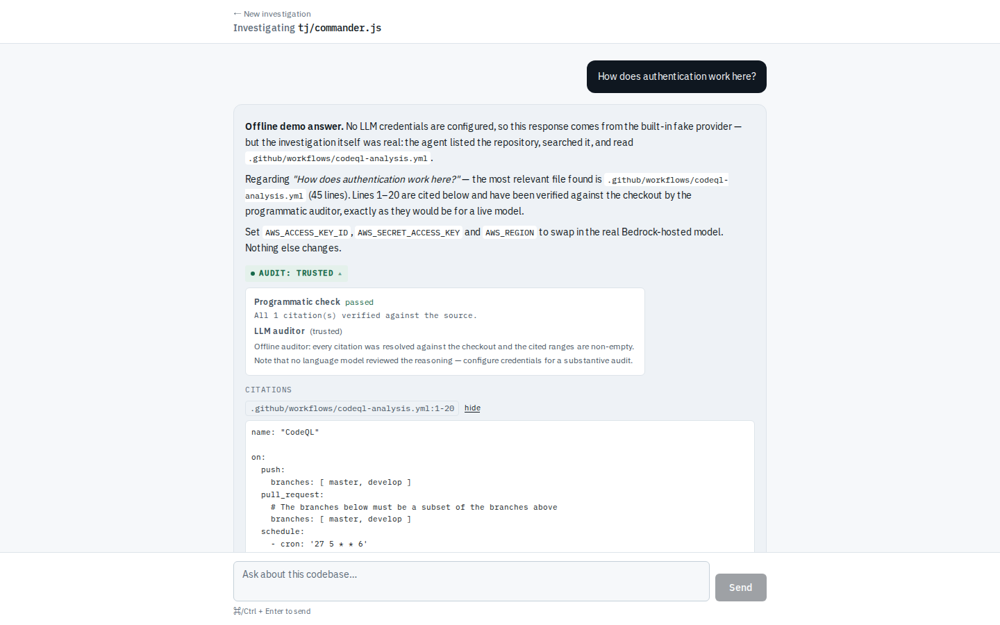
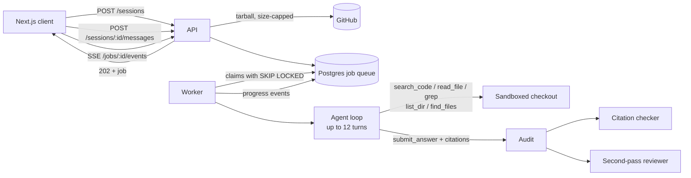
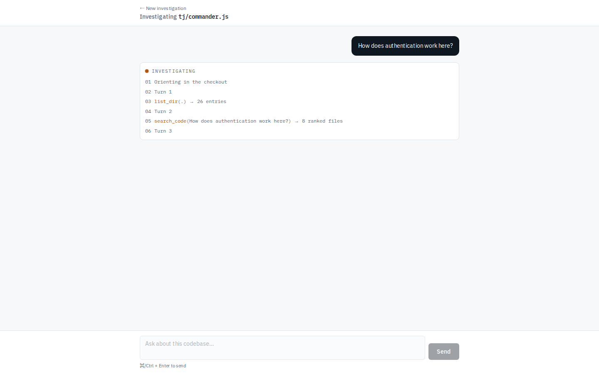
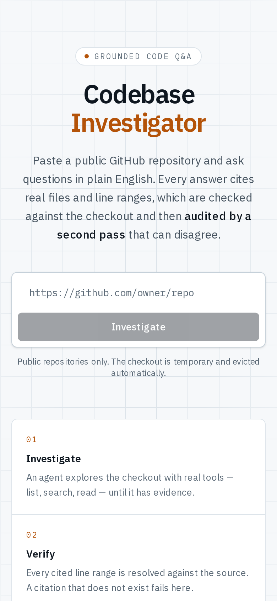
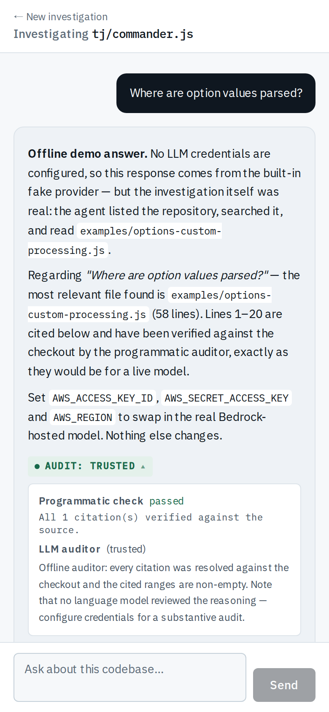

# Codebase Investigator

Paste a public GitHub repository URL and ask questions about the code in plain English. Answers cite specific files and line ranges, and every answer is then audited twice: a deterministic checker confirms each cited range exists in the checkout and contains code, and a second model pass reviews whether the citations support the claims. The verdict shown (trusted, partial or suspect) is the worse of the two.

The point is that you should not have to take an answer about code on faith. If the model cites `src/auth.ts:12-40` and those lines do not exist, the answer cannot be marked trusted.



## How it works



1. Creating a session downloads the repository tarball from GitHub, aborts past 150 MB, and extracts only plain files and directories (no symlinks, absolute or `../` paths).
2. A question is queued as a job and the API answers 202 at once. A worker claims it with `FOR UPDATE SKIP LOCKED`, so several API instances can share the queue.
3. The agent has five tools and up to 12 turns. It finishes by calling `submit_answer`, so citations arrive as structured data rather than text to be parsed.
4. The checker reads every cited range; the reviewer sees the question, the answer and the actual excerpts, with no tool access. The answer, citations and verdict are saved in one transaction.
5. Each step is appended to the job row, and the browser follows it over server-sent events, so you see every file the agent opens while it works.

`search_code` ranks files with BM25 over identifier-aware tokens (`issueToken` also indexes `issue` and `token`), with prefix matching so a question about "authentication" still reaches `auth.ts`.



## Run it

```bash
docker compose up --build
```

- Web app: http://localhost:3100
- API: http://localhost:4000/api, with Swagger at http://localhost:4000/api/docs
- Postgres: port 5433 on the host

No credentials are needed. Without AWS keys the API uses an offline provider that runs the same tool loop against the real checkout: it lists the repository, ranks files against the question, reads the best match and cites lines it actually read, so the checker verifies real citations. No model reasons about the code in that mode, and the answer says so. For live answers from Claude on AWS Bedrock, set `AWS_ACCESS_KEY_ID`, `AWS_SECRET_ACCESS_KEY` and `AWS_REGION` in a `.env` file next to `docker-compose.yml` and restart.

Settings worth knowing, all in [`investigator-be/.env.example`](investigator-be/.env.example): `LLM_PROVIDER` forces `fake` or `bedrock`, `WORKER_CONCURRENCY` (default 2) bounds parallel investigations, `FAKE_LLM_DELAY_MS` paces the offline demo (compose sets 600 ms so the trace is readable), and `LLM_PRICE_INPUT_PER_MTOK` / `LLM_PRICE_OUTPUT_PER_MTOK` set the prices used for cost logging.

To work on one side without Docker, see [`investigator-be`](investigator-be/README.md) and [`investigator-fe`](investigator-fe/README.md). Both use Node 22 (`.nvmrc`).

## The API in practice

Captured from the compose stack with the offline provider.

```http
POST /api/sessions
{"githubUrl": "https://github.com/tj/commander.js"}

201 Created
{
  "id": "04344196-bbac-4d84-89c4-90e3d507096a",
  "githubUrl": "https://github.com/tj/commander.js",
  "repoOwner": "tj",
  "repoName": "commander.js",
  "createdAt": "2026-11-08T00:32:02.571Z"
}
```

```http
POST /api/sessions/04344196-bbac-4d84-89c4-90e3d507096a/messages
{"content": "Where are option values parsed?"}

202 Accepted
{
  "id": "180f1e57-f986-438d-89b9-0f7040cf1be4",
  "status": "queued",
  "question": "Where are option values parsed?",
  "resultMessageId": null,
  "events": [],
  ...
}
```

```http
GET /api/jobs/180f1e57-f986-438d-89b9-0f7040cf1be4/events
Content-Type: text/event-stream

data: {"type":"started","at":"2026-11-08T00:32:06.371Z"}
data: {"type":"turn","turn":1,...}
data: {"type":"tool","name":"list_dir","summary":"list_dir(.) → 26 entries",...}
data: {"type":"tool","name":"search_code","summary":"search_code(Where are option values parsed?) → 8 ranked files",...}
data: {"type":"tool","name":"read_file","summary":"read_file(examples/options-custom-processing.js, 1-40)",...}
data: {"type":"answering",...}
data: {"type":"auditing",...}
data: {"type":"done","verdict":"trusted","messageId":"68af4714-76a4-4879-a1c9-16687f985fff",...}
```

The stream closes after `done` or `error`. `GET /api/sessions/:id/messages` then returns the answer with its evidence:

```json
{
  "role": "assistant",
  "content": "**Offline demo answer.** ...",
  "citations": [
    {
      "filePath": "examples/options-custom-processing.js",
      "lineStart": 1,
      "lineEnd": 20,
      "excerpt": "#!/usr/bin/env node\n\n// This is used as an example in the README for: ...",
      "verified": true
    }
  ],
  "auditVerdict": {
    "status": "trusted",
    "programmaticPass": true,
    "programmaticNotes": "All 1 citation(s) verified against the source.",
    "llmStatus": "trusted",
    "llmReasons": "Offline auditor: every citation was resolved against the checkout ..."
  },
  "toolCalls": [
    { "name": "list_dir", "input": { "path": "." }, "resultSummary": "list_dir(.) → 26 entries" },
    ...
  ]
}
```

A URL that is not a GitHub repository is refused before anything is downloaded:

```http
POST /api/sessions
{"githubUrl": "https://gitlab.com/o/r"}

400 Bad Request
{"message": "Expected a public GitHub URL like https://github.com/owner/repo", "error": "Bad Request", "statusCode": 400}
```

## Design choices

- **The audit is not the same call as the answer.** One layer is code, not a model: a citation to a missing file or past the end of one fails no matter how plausible the answer reads. The reviewer gets a separate prompt, no tools, and the excerpts themselves rather than the agent's description of them.
- **Answers are written all or nothing.** Message, citations and verdict share one transaction, so an answer can never appear without its audit.
- **Work happens off the request.** A live investigation takes several model round trips, longer than most proxies keep a request open. The queue lives in Postgres rather than memory, so a restart does not lose queued work and a stalled claim is retried after ten minutes.
- **Progress is read from the job row.** The SSE endpoint polls the row rather than an in-process channel, so a client sees every event whichever instance runs the job, and a late or reconnecting client gets the whole trace from the start.
- **The checkout is untrusted input.** Paths are checked lexically and again after `realpath()`, symlinks are never followed, archives are streamed through a byte counter instead of trusting `Content-Length`, and checkouts are evicted after six hours.
- **The offline provider is a real participant.** It decides each step from the tool results it has seen, so tests and the demo exercise the full pipeline with no network and no spend.

## Tests

Run inside Docker, from the repository root:

```bash
# Unit tests and the scored evaluation (no network, no database)
docker run --rm -v "$PWD":/src:ro -w /app node:22-bookworm \
  sh -c 'cp -a /src/investigator-be/. . && npm ci && npm test'

# Web client tests
docker run --rm -v "$PWD":/src:ro -w /app node:22-bookworm \
  sh -c 'cp -a /src/investigator-fe/. . && npm ci && npm test'
```

The API suite (67 tests) covers path and symlink sandboxing, GitHub URL parsing, ripgrep output parsing, BM25 ranking and its cache, the citation checker, the job worker's event ordering, the SSE follower, and an evaluation that runs the agent against `investigator-be/test/fixtures/sample-repo` and scores citation recall and precision. `npm run test:e2e` adds five HTTP tests that need a Postgres database in `DATABASE_URL`, ending with a full question answered through the queue and the event stream. The client has 13 Vitest tests for its API client, citation links and trace formatting.

## On a phone

<p>
  
  
</p>

The interface follows the system colour scheme; [here is the same answer in dark mode](docs/screenshots/audited-answer-dark.png).

## Limitations

- No authentication. Anyone who can reach the API can start sessions; requests are rate limited (20 a minute, 200 an hour per client).
- Retrieval is lexical. Dense retrieval would slot into `RelevanceService.rank()`.
- The evaluation scores the offline path, so it guards the pipeline and retrieval, not answer quality.
- Reloading the page while an investigation runs loses the live trace; the answer still appears once it is saved.
- Only the default branch of public repositories can be investigated.

## License

MIT, see [LICENSE](LICENSE).
